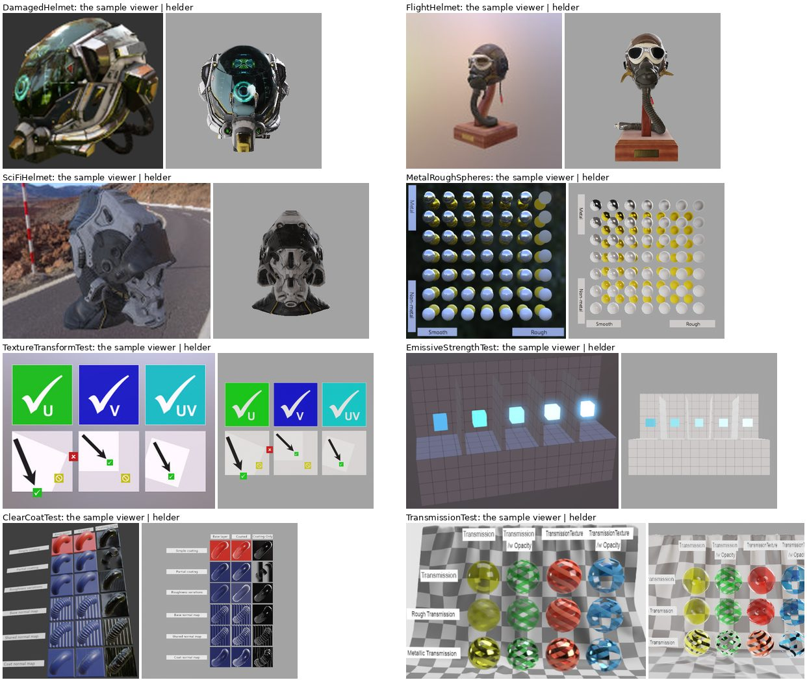

# glTF sample models

Khronos' [glTF sample models](https://github.com/KhronosGroup/glTF-Sample-Assets),
the scenes other engines demo with, in helder.scene: DamagedHelmet,
FlightHelmet, SciFiHelmet and MetalRoughSpheres, and the tests of the glTF
extensions helder reads: KHR_texture_transform, KHR_materials_emissive_strength,
KHR_materials_clearcoat and KHR_materials_transmission. A model picker and an
environment picker over a `<Scene hdr>` with `<OrbitControls>`; prefiltered
image-based light (`Environment.prefiltered`), bloom and ACES (`PostProcess`).

```sh
node examples/gltf-showcase/fetch.mjs                     # the models, into models/ (91 MB, git-ignored)
bun run helder examples/gltf-showcase/GltfShowcase.hx     # natively
bun run helder examples/gltf-showcase/GltfShowcase.hx --target web
```

- `fetch.mjs` downloads each model from glTF-Sample-Assets at a pinned
  commit, a `.gltf`'s buffers and images packed into one `.glb` (what
  `Model.load` reads), with its `metadata.json` (its licences and credits) and
  the sample viewer's reference render beside it. The site's build runs it
  (`// data: models`) and serves the models beside the module.
- `envbake.py` filters a Radiance `.hdr` panorama into the atlas
  `Environment.prefiltered` reads (GGX rows by roughness and the irradiance,
  256 wide), scaled to fit 8 bits (the scale is the environment's
  intensity). `environments/` holds three, from Poly Haven's CC0 panoramas
  (studio_small_09, venice_sunset, kloofendal_48d_partly_cloudy_puresky).
- `Showcase.hx` is the scene (the models, the environments, the camera
  fitted to the bounds), shared by the example and by `Shots.hx`, which
  draws each model headless for the comparison below.
- The program prints `stats: {...}` lines (the first frame, the download, the
  GPU's texture bytes, frame times' p50 and p99); `site/numbers.mjs` reads
  them for the site's page of this example.

## Against the sample viewer

Each model's reference render (its `screenshot/` image in glTF-Sample-Assets,
the Khronos sample viewer's, at its own size, camera and environment) beside
helder's frame (`Shots.hx`: the file's camera where it has one, else from
the front; the studio environment lighting it, not drawn; HDR, bloom, ACES;
Mesa's llvmpipe):



```sh
helder build examples/gltf-showcase/Shots.hx -o bin/shots
LIBGL_ALWAYS_SOFTWARE=1 bin/shots examples/gltf-showcase bin/shots-out
```

| Model | | |
| --- | --- | --- |
| DamagedHelmet | correct | metallic-roughness, occlusion, emissive and normal maps; the pose and environment differ |
| FlightHelmet | correct | six materials, normal maps; the lenses' transmission tinted (below) |
| SciFiHelmet | correct | |
| MetalRoughSpheres | correct | metal and roughness by the texture's rows and columns |
| TextureTransformTest | correct | offset, rotation and scale: every check mark where the test puts it, no cross |
| EmissiveStrengthTest | correct | brighter left to right (strengths 1 to 16); the reference's darker grid and stronger glow are its exposure and bloom |
| ClearCoatTest | mostly | the coat's factor and roughness, its reflection of the sun and the environment over the base; not its textures (clearcoatTexture, clearcoatRoughnessTexture, clearcoatNormalTexture): the partial coat and coat normal rows show the coat whole and smooth |
| TransmissionTest | mostly | a thin surface: what is behind multiplied by the base colour (a first draw blended Multiply), the reflections over it; not transmissionTexture (the textured columns transmit everywhere), nor rough transmission's blur (no refraction, no screen-space copy of the frame) |

alphaMode MASK (TransmissionTest's opacity column) is cut out (`discard()`,
new in gfx's shaders). The 3d lane's goldens `khrtransform` and
`khrclearcoat` (tests/3d) draw TextureTransformTest and ClearCoatTest,
vendored there (CC0, CC BY 4.0).

## Credits

- DamagedHelmet: CC BY 4.0 ctxwing (rebuild and glTF), after theblueturtle_ (CC BY-NC 4.0)
- FlightHelmet: CC0 Gary Hsu
- SciFiHelmet: CC0 Michael Pavlovic, Norbert Nopper
- MetalRoughSpheres, EmissiveStrengthTest, ClearCoatTest: CC BY 4.0 Ed Mackey
- TextureTransformTest: CC0 Microsoft
- TransmissionTest: CC0 Adobe
- The reference renders in `comparison.jpg`: from glTF-Sample-Assets, under the models' licences
- Panoramas: Poly Haven, CC0
